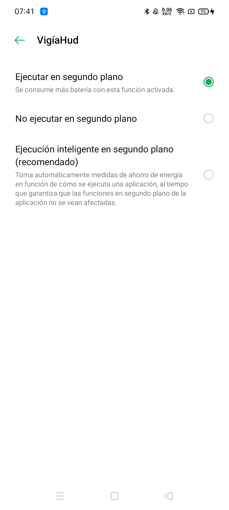

# El móvil: ajustes para que la vigilancia sobreviva

Validado en un OPPO A5 2020 con Android 10 y ColorOS 7.1 (`DECISIONS.md` 003). Los nombres de los menús son los de
ese móvil; en otras versiones de ColorOS cambian de sitio, pero existen los mismos interruptores.

ColorOS mata procesos en segundo plano con más agresividad que Android. No hay nada que la app pueda hacer desde el
código contra eso: hay que concederle estos permisos a mano, una vez, y comprobarlos si alguna vez deja de llegar el
latido.

## 1. Optimización de batería: excluir la app

Es el único ajuste que la app puede pedir ella misma. En la pantalla principal, panel **MÓVIL**: si pone
"Optimización de batería: activa" en rojo, pulsa **EXCLUIR DE BATERÍA** y acepta el diálogo de Android
("¿Permitir que VigíaHud ignore la optimización de batería?" > **Permitir**). El panel pasa a verde.

Qué hace: con la app excluida, Android respeta su wake lock también en modo reposo (Doze) y no la cuenta entre las
apps "inactivas". Sin esto, el servicio puede quedarse sin CPU durante los periodos de reposo.

Comprobación desde el PC: `adb shell dumpsys deviceidle whitelist | grep vigiahud`.
En el registro, al arrancar el servicio: `info battery optimization ignored=yes`.

## 2. Ajustes de la app en ColorOS

Pulsa **AJUSTES DE LA APP** (abre "Información de la aplicación" de VigíaHud) y revisa:



| Ajuste | Dónde | Valor |
|---|---|---|
| Ejecutar en segundo plano | Ficha de la app > **Uso de la batería** | **Ejecutar en segundo plano** (no "Ejecución inteligente", que es la de fábrica y la que mató el servicio al desenchufar) |
| Inicio automático | Gestor de inicio de ColorOS (en Ajustes, busca "Inicio automático"; la app no puede abrirlo) | Activado |
| Notificaciones | Ficha de la app > Notificaciones | Permitidas (la notificación permanente es lo que mantiene vivo el servicio) |
| Cámara | Ficha de la app > Permisos | Permitida |

Y en **Ajustes > Batería**: desactiva el ahorro de energía y cualquier "optimización inteligente" o "modo de
reposo" que afecte a VigíaHud.

## 3. Candado en recientes

Abre el conmutador de apps recientes, localiza VigíaHud y bloquéala (candado, o deslizar hacia abajo sobre la
tarjeta y tocar el candado). Así "limpiar todo" no la cierra.

## 4. Pantalla y bloqueo

- La pantalla se apaga sola (30 s por defecto): es lo que queremos. El servicio sigue con la pantalla apagada.
- No hace falta desbloquear el móvil para que vigile. Solo para abrir la app.
- Durante el desarrollo, para poder hacer capturas desde el PC, conviene activar
  Opciones de desarrollador > "Pantalla siempre activa" y quitarlo después.

## 5. USB y adb (solo para desarrollo)

Al conectar el cable, ColorOS vuelve al modo **MIDI** y `adb` no ve el móvil. En la notificación de USB elige
"Transferencia de archivos", o fija en Opciones de desarrollador > "Configuración de USB predeterminada" >
"Transferencia de archivos" para no repetirlo. `adb` está en
`C:\Program Files (x86)\Android\android-sdk\platform-tools\adb.exe`.

Lecturas útiles con la app en Debug:

```
adb shell run-as com.vigiahud.app cat files/logs/vigia.log
adb shell run-as com.vigiahud.app ls files/snapshots
adb shell dumpsys activity services com.vigiahud.app
adb shell dumpsys power | grep VigiaHud
```

## Plan B si el juez de 24 h falla

Si con todo lo anterior el registro muestra huecos mayores de un minuto, la alternativa documentada en `PLAN.md` es
mantener la pantalla encendida en negro con brillo mínimo (`FLAG_KEEP_SCREEN_ON` con una actividad negra). Solo se
construirá si hace falta: consume más y gasta la pantalla.
